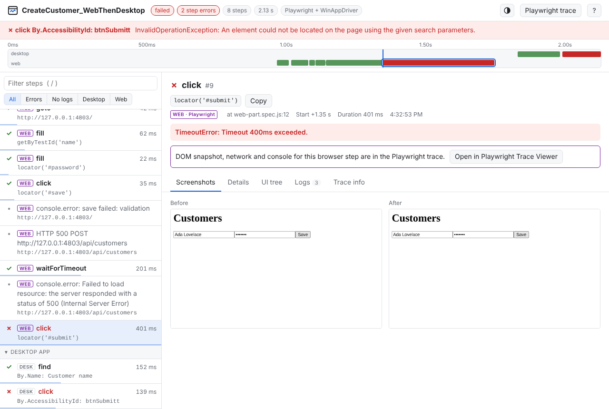

# Combining with Playwright traces

Tests that drive a web app with Playwright and a desktop app with WinAppDriver produce two traces. WinTrace can merge
the Playwright trace into its own, so one timeline shows the whole test, while the original Playwright trace stays
whole and opens in Playwright's trace viewer with everything it offers.



## What you get

| In the WinTrace trace | Kept from Playwright |
|---|---|
| Each Playwright action as a **web** step: name, readable locator (`getByTestId('name')`), values typed (passwords hidden), duration, error, call log, and the test source line that issued it | The original `trace.zip`, inside the WinTrace zip (`playwright/`) and inside the HTML report |
| Before/after screenshots from Playwright's screencast | DOM snapshots before, during and after each action |
| Browser `console.error` / `console.warning` and failed requests (HTTP 4xx/5xx, network failures) on the timeline | Every network request with headers and bodies, the full console, sources, attachments |
| Web and desktop steps interleaved by time, in the viewer, the `.md` report, `wintrace summary/inspect/list` | Playwright's own viewer: one click in the WinTrace viewer ("Playwright trace") |

## Recording both in one test (Playwright .NET)

Start Playwright tracing as usual, stop it with a path, then import the file before finishing the WinTrace session:

```csharp
// setup
await Context.Tracing.StartAsync(new() { Screenshots = true, Snapshots = true, Sources = true });
_trace = new TraceSession(TestContext.TestName!, new AppiumTraceSource(() => DesktopSession));

// cleanup
var failed = TestContext.CurrentTestOutcome != UnitTestOutcome.Passed;
var playwrightTrace = Path.Combine(outputDir, $"{TestContext.TestName}_playwright.zip");
await Context.Tracing.StopAsync(new() { Path = playwrightTrace });
_trace.Recorder.ImportPlaywrightTrace(playwrightTrace);
_trace.Finish(failed, TestContext.AddResultFile);
```

- Import after tracing stopped (the file must be complete) and before `Finish`.
- If your suite only writes the Playwright trace when a test fails, import it only when the file exists.
- An unreadable file never fails the test: the problem is logged in the trace and the rest is kept.
- Values typed into fields whose locator says "password" (or `secret`, `token`, see `TraceOptions.RedactParams`) are
  shown as `***` in the WinTrace steps. The original Playwright trace is kept as Playwright wrote it.

## Merging traces after the fact

```
wintrace merge Login_20261030_101500_failed.zip Login_playwright.zip      # WinTrace + Playwright
wintrace merge Login_playwright.zip --title "Login (web only)"             # Playwright only
```

Both write a `.zip`, a self-contained `.html` and a `.md` next to the first file (`--out` to choose). Converting a
Playwright-only trace gives web-only tests the same Markdown report and `wintrace inspect`/`list` support, which
is handy for AI agents.

## Opening the original in Playwright's viewer

In the WinTrace viewer, click **Playwright trace** (header) or **Open in Playwright Trace Viewer** on a web step:

1. **Download trace** saves the original Playwright zip (it was embedded in the HTML).
2. **Open trace.playwright.dev** and drop the file there. It is processed in your browser, not uploaded.

Or locally, from the test project: `pwsh bin/Debug/net8.0/playwright.ps1 show-trace <file>` (Playwright .NET) or
`npx playwright show-trace <file>`.

To keep the HTML small, set `TraceSession.EmbedPlaywrightTracesInHtml = false`: the Playwright zip is then copied
next to the report (`<name>_files/`) and passed to the `attach` callback; it is always in the WinTrace zip.

## Compatibility

The Playwright trace format is internal to Playwright and changes between versions. WinTrace reads current and
older layouts (`class`/`method` and the older `apiName`) and skips what it does not understand. If a future version
changes the format, the web steps may be incomplete, but the original trace is still kept and opens in Playwright's
viewer. Tested with Playwright 1.63 traces.
