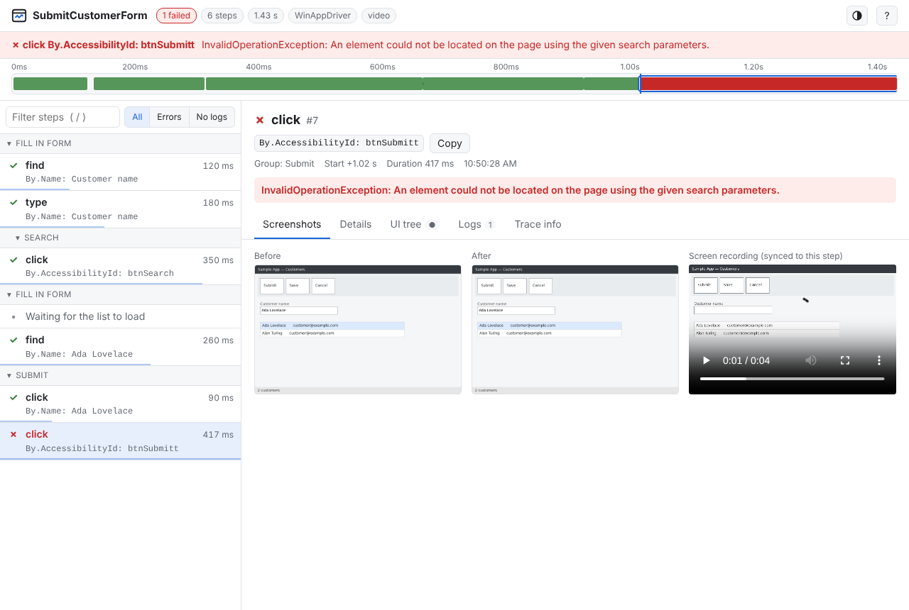
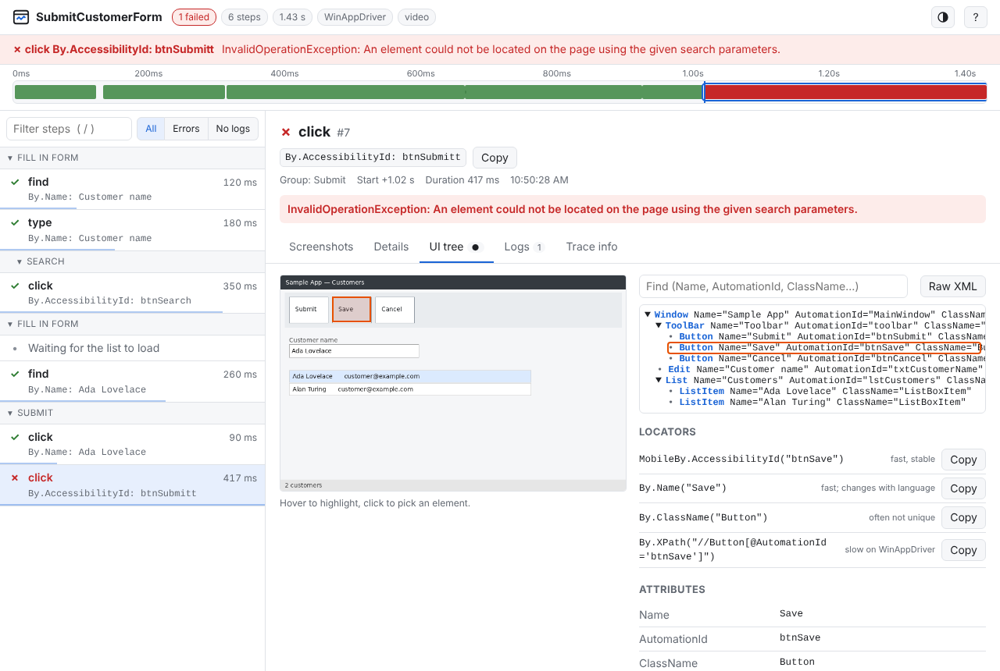
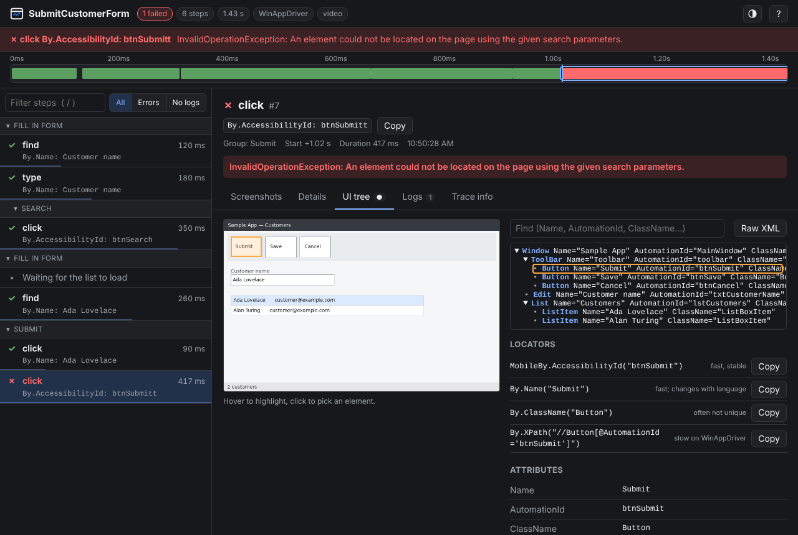

# Using the viewer

The viewer is the `.html` file written next to each `trace.zip`. It is self-contained: open it in any
browser, attach it to a bug, or publish it as a CI artifact. No server and no installation.

To rebuild it from a zip (for example a trace someone sent you):

```
wintrace show trace.zip            # writes trace.html next to the zip and opens it
wintrace show trace.zip --out report.html --no-open
```



## Layout

- **Header:** test name and a summary: the test outcome reported by the test framework, number of steps,
  duration, driver, video. Steps that threw in a test that still passed are counted as *recovered errors*
  (orange).
- **Failure banner:** the step where the test failed and its error, or "Test failed outside the recorded steps"
  with the failure message. Click it to jump there.
- **Timeline:** every step drawn to scale; failures in red, logs as thin marks. Hover a step to see its
  screenshot; click to select it.
- **Step list (left):** grouped as in your test. Click a group header to collapse it. The thin bar under each
  step shows its duration relative to the slowest step, so slow steps stand out.
- **Filters:** free text (matches name, locator, error, group and parameters), **Errors** only, or
  **No logs**.

The report opens on the step where the test failed. A step that failed because a nested step failed shows
`↳ failed in #N` and links to that step, where the screenshot and UI tree were captured once. Each step has its own link (`report.html#7`), so you can point a
colleague to the exact step.

## Tabs

| Tab | Shows |
|---|---|
| **Screenshots** | Before and after the step (one screenshot for log entries taken with `screenshot: true`). Click to enlarge; use ← → in the enlarged view. When the trace has a video, it plays here, positioned at the selected step; with several segments it switches to the one covering the step. |
| **Details** | Step name, locator, group, timing (duration, and capture time with the UI tree part), parameters (with passwords hidden), error and full stack trace. |
| **UI tree** | The UI Automation tree captured for the step (by default only for failed steps). See below. |
| **Logs** | All `rec.Log` messages with their time. Click one to jump to it. |
| **Trace info** | Machine, OS, driver, start and stop time, number of steps, video file. |

## UI tree and locator picker



The UI tree tab shows the tree captured when the step ran, next to the screenshot:

- **Hover the screenshot** to highlight the element under the mouse. **Click** to pick it: the tree jumps to
  that element and the panel below lists ready-to-copy locators (`MobileBy.AccessibilityId`, `By.Name`,
  `By.ClassName`, `By.XPath`) with a note on each. XPath is listed last because it is slow on WinAppDriver.
- **Hover a tree node** to highlight it on the screenshot; click to pick it.
- **Find** searches names, AutomationIds and class names and opens the branches that match.
- **Raw XML** shows the tree exactly as the driver returned it.

When a "find" or "click" fails, the viewer preselects the element whose AutomationId or Name is closest to
the locator that failed. A typo such as `btnSubmitt` points straight at `btnSubmit`.

The highlight assumes the screenshot shows the root element of the tree (the app window, or the whole
desktop for a Root session). If boxes look shifted, see [Troubleshooting](troubleshooting.md#highlight-boxes-are-shifted).

## Video

The video is embedded in the HTML by default, so the file works on its own, also when opened from a CI test
attachment. When it was written next to the report instead (`EmbedVideoInHtml = false`), keep the
`<name>_files/` folder with the HTML. Served from a web server that does not support range requests, the viewer
loads the video whole so it can still seek.

## Keyboard shortcuts

| Key | Action |
|---|---|
| `↓` `j` / `↑` `k` | Next / previous step |
| `e` | Next error |
| `/` | Filter steps |
| `1` … `5` | Switch tab |
| `t` | Toggle light / dark theme |
| `?` | Show shortcuts |
| `Esc` | Close the enlarged image or dialog, leave the filter |

The viewer follows the system light or dark setting until you choose a theme with `t`.


